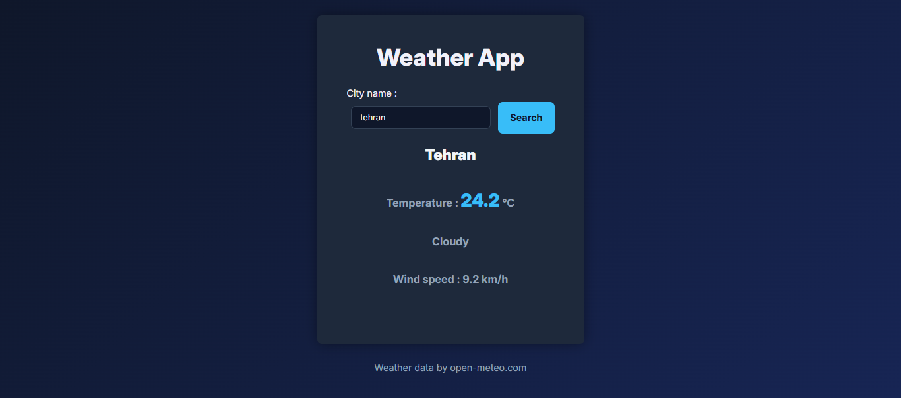

# Weather-app

A responsive weather app built with HTML, CSS and JavaScript. Search for any city and see its current temperature, weather conditions and wind speed.

🔗 **Live Demo:** https://amir0rr.github.io/Weather-app/



## Features

- Search weather by city name
- Shows current temperature, weather conditions and wind speed
- Loading message while data is being fetched
- Clear messages for empty input, unknown cities and network errors
- Search button is disabled during a request to prevent duplicate requests
- Dark theme with a responsive layout (desktop, tablet, mobile)

## Built With

- HTML5
- CSS3 (Flexbox, media queries)
- JavaScript (DOM manipulation, events, fetch api, async/await, try/catch/finally)

## Data Source

Weather data by [Open-Meteo.com](https://open-meteo.com/), licensed under [CC BY 4.0](https://creativecommons.org/licenses/by/4.0/). City lookup uses the Open-Meteo Geocoding API, which is based on [GeoNames](https://www.geonames.org/) data. Weather codes are converted to text by this project.

This project was built for learning purposes and non-commercial use only. It is not affiliated with or endorsed by Open-Meteo.

## What I Learned

- Sending requests to APIs with `fetch`, `async` and `await`
- Chaining two API requests (geocoding first, then forecast)
- Working with JSON data and reading values from nested objects
- Handling errors with `try`, `catch` and `finally`, and checking `response.ok`
- Showing loading and error states in the UI
- Converting weather codes to readable text with a helper function
- Using the browser DevTools (Console and Network) to debug requests

## Run Locally

```bash
git clone https://github.com/Amir0rr/Weather-app.git
```

Then open `index.html` in your browser.
